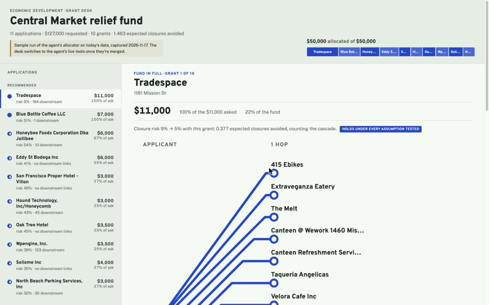

# MainStreetRelief: the Smart Grant Agent

An agent that helps a city grant officer split a small relief budget across a queue of
applicants. It weighs each grant by how distressed the applicant is **and** by what the grant
keeps standing downstream. It walks a BigQuery property graph of real San Francisco businesses
to find who depends on whom, then makes a recommendation the officer can defend line by line.

**Agents for Impact 2026, Challenge 3 (Community Economic Resilience & Micro-Grants).**
Track: **Main Street relief**. Corridor: **Central Market, San Francisco** (230 businesses).
Scenario: *"We run relief funding for Central Market. We have $50,000 and 11 applicants asking
for $118,000. Who should we fund, how much, and why?"*

| | Link |
|---|---|
| **Live demo: the grant desk** | https://grant-desk-173086820802.us-west2.run.app |
| The agent (ADK API server and dev UI) | https://grant-agent-173086820802.us-west2.run.app |
| MCP Toolbox for Databases | https://toolbox-173086820802.us-west2.run.app |
| Google Cloud lab project | `qwiklabs-gcp-04-524776bdd295` (Cloud Run in us-west2, BigQuery dataset `a4i_econ` in US) |
| Product requirements | [docs/PRD.pdf](docs/PRD.pdf), with build status in [docs/REQUIREMENTS.md](docs/REQUIREMENTS.md) |



### For judges: where each rubric line is answered

| Rubric | Evidence |
|---|---|
| **Impact & insight** (30) | [The recommendation on the live data](#the-recommendation-on-the-live-data): who to fund, how much, the cascade, the runner-up. Open the [live desk](https://grant-desk-173086820802.us-west2.run.app) and ask the agent "We have $50,000. Who should we fund?" |
| **Technical execution** (30) | A deployed ADK agent with a real multi-hop `MATCH` over a BigQuery property graph: [How it works](#how-it-works), [requirements map](#challenge-requirements-and-where-each-is-met), [docs/ARCHITECTURE.md](docs/ARCHITECTURE.md) |
| **Rigor & judgment** (25) | [What is real and what is modeled](#what-is-real-and-what-is-modeled) · [Validation and equity audit](#validation-and-equity-audit) · [Hub check](#hub-check-the-same-50000-three-ways), on when we don't fund the biggest hub · [Limitations](#limitations) · every assumption in [`allocator.py`](agent/grant_agent/allocator.py) with a [sensitivity check](agent/README.md#the-allocator-grant_agentallocatorpy) |
| **Craft & communication** (15) | The grant desk: a funding queue with one line map per applicant, because the officer has to defend a list, not read a chat log ([frontend/README.md](frontend/README.md)) |
| **Bonus: range** | MCP Toolbox for Databases on Cloud Run, a custom funding-queue UI, a sensitivity analysis across five alternative assumptions, and a census fix that recovered neighborhood data for 228 of 230 businesses |

---

## What the officer gets

The officer opens the **grant desk**, a funding queue with a $50,000 budget bar. For each
applicant it shows:

- the recommended award, and what share of the request that is
- closure risk before and after the grant
- the businesses that depend on it, drawn as a transit-style line map
- the reasons, in plain English
- the runner-up, and the assumptions
- which awards hold under every assumption tested
- the neighborhood's poverty rate

An **Ask the agent** box takes follow-up questions in plain language, such as "Why not
Tradespace?", "What does $8,000 change?" or "Whose neighborhood does this help?"

Every number comes from code: a multi-hop graph query in BigQuery and a deterministic Python
allocator. Gemini decides which tools to call and writes the prose around their results. It does
not compute amounts or cascades.

### The recommendation on the live data

`recommend_grants(50000)` on the live tables, 2026-11-17, with traversal depth 2. Grants are
listed in priority order: closures avoided, weighted toward poorer tracts. The last column is
the unweighted count.

| # | Business | Award | Closure risk before → after | Businesses downstream | Expected closures avoided |
|---|---|---|---|---:|---:|
| 1 | Sour Flour | $5,000 of $5,000 (100%) | 42% → 25% | 97 | 3.14 |
| 2 | Eddy St Bodega | $9,000 of $11,000 (82%) | 41% → 26% | 0 | 0.15 |
| 3 | Honeybee Foods (Jollibee) | $9,000 of $9,000 (100%) | 54% → 33% | 1 | 0.17 |
| 4 | Blue Bottle Coffee | $7,000 of $7,000 (100%) | 51% → 31% | 1 | 0.16 |
| 5 | San Francisco Proper Hotel, Villon | $6,000 of $11,000 (55%) | 49% → 35% | 0 | 0.13 |
| 6 | The Warfield Theater | $4,000 of $15,000 (27%) | 35% → 28% | 7 | 0.08 |
| 7 | Oak Tree Hotel | $3,500 of $14,000 (25%) | 45% → 36% | 0 | 0.07 |
| 8 | Soliome | $4,000 of $15,000 (27%) | 35% → 28% | 0 | 0.07 |
| 9 | Non Plus Ultra | $2,000 of $8,000 (25%) | 25% → 20% | 6 | 0.05 |
| — | Supremo Pizza (runner-up) | not funded, asked $12,000 | 17% | 1 | — |
| — | Tradespace (the hub) | not funded, asked $11,000 | 9% | 1 | — |

$49,500 allocated, **4.18 expected business closures avoided** in total. Every business,
applicant or downstream, is counted once. Six awards are made in every assumption set tested:
Sour Flour, Eddy St Bodega, Blue Bottle, the Proper Hotel, the Warfield Theater and Non Plus
Ultra. Honeybee, Oak Tree and Soliome depend on the assumptions.

**The graph changes the decision.** By distress alone, Sour Flour ranks 5th of 11. It is grant 1
because 97 businesses are modeled as depending on it: 69 directly and 28 more two hops out. That
one $5,000 grant accounts for 3.14 of the 4.18 expected closures avoided.

**The agent does not fund the biggest hub.** Tradespace (data hosting) has the most supply links
in the corridor: 113 buyers. But almost all of those links are weak and generic, about 1.5 cents
per input dollar. A chain counts only if every link is at least 2 cents. That leaves one dependent
business. Its finances are also strong (9% closure risk), so money there changes little.

### Hub check: the same $50,000, three ways

These are the two approaches the brief warns about, set against ours.
[`scripts/hub_check.py`](scripts/hub_check.py) reproduces them from the live tables.

| Applicant | Supply links | Closure risk | Downstream (every link ≥ 0.02) | Centrality only | Distress only | **Ours** |
|---|---:|---:|---:|---:|---:|---:|
| Tradespace | 113 | 9% | 1 | $11,000 | — | **—** |
| Sour Flour | 84 | 42% | 97 | $5,000 | $5,000 | **$5,000** |
| The Warfield Theater | 5 | 35% | 7 | $15,000 | — | **$4,000** |
| Non Plus Ultra | 4 | 25% | 6 | $8,000 | — | **$2,000** |
| Honeybee Foods (Jollibee) | 2 | 54% | 1 | $9,000 | $9,000 | **$9,000** |
| Supremo Pizza | 1 | 17% | 1 | — | — | **—** |
| Blue Bottle Coffee | 1 | 51% | 1 | — | $7,000 | **$7,000** |
| Oak Tree Hotel | 0 | 45% | 0 | — | $14,000 | **$3,500** |
| SF Proper Hotel, Villon | 0 | 49% | 0 | — | $11,000 | **$6,000** |
| Soliome | 0 | 35% | 0 | — | — | **$4,000** |
| Eddy St Bodega | 0 | 41% | 0 | — | — | **$9,000** |
| **Expected closures avoided** | | | | 3.78 | 3.94 | **4.18** |

- **Centrality only** gives $11,000 to the healthiest applicant, Tradespace, for links that
  carry almost nothing. It also puts $15,000 into the Warfield's small cascade.
- **Distress only** spends $25,000 on two hotels with no businesses downstream. It skips the
  Warfield and Non Plus Ultra, whose cascades are real.
- **Ours** funds both kinds of case. It gives partial grants where diminishing returns make
  splitting worth more. It reaches Eddy St Bodega, in the corridor's poorest tract (36% poverty),
  which both rankings skip.

The totals use our own model, so treat them with care. Our allocator optimizes a need-weighted
version of that model, but these totals are the unweighted count. Ours leads on that count too.
What matters more is who moves between the lists, and that each move has a reason the officer
can say out loud.

Applicant financials are illustrative. The businesses are real, but the revenue drop, cash on
hand and requested amount are generated for the demo, and flagged `illustrative = TRUE`.

---

## How it works

```mermaid
flowchart LR
    officer([Grant officer]) --> desk["<b>Grant desk</b><br/>FastAPI + web UI<br/>frontend/"]
    desk -- "queue and line maps<br/>(same Python tools)" --> tools
    desk -- "Ask the agent" --> agent["<b>ADK agent</b><br/>agent/grant_agent/"]
    agent -- "plans, writes prose" --> gemini[("Gemini 2.5 Flash<br/>Vertex AI")]
    agent --> tools["<b>Our tools</b><br/>get_cascade · recommend_grants<br/>exposed_non_applicants"]
    agent -- MCP --> toolbox["<b>MCP Toolbox</b><br/>4 read-only SQL tools"]
    tools -- "multi-hop GQL MATCH" --> graph[["BigQuery property graph<br/>a4i_econ.LocalEconomy"]]
    tools --> alloc["<b>allocator.py</b><br/>risk × cascade × need<br/>→ awards"]
    toolbox --> bq[("BigQuery tables<br/>a4i_econ")]
```

1. **The graph.** [`sql/01_create_graph.sql`](sql/01_create_graph.sql) builds `LocalEconomy`.
   It has two node types: `Business` (230) and `Employer` (122 census blocks). It has two edge
   types: `Supplies` (supplier → buyer, 994 edges) and `DrawsFootfall` (census block → business,
   1,016 edges). Arrows point from the thing depended on to the thing that depends on it.
2. **The traversal.** [`get_cascade`](agent/grant_agent/tools.py) and `recommend_grants` follow
   `Supplies` forward, one to three hops (default two). They drop any chain with a link under
   0.02 and keep the strongest path to each exposed business:

   ```sql
   GRAPH a4i_econ.LocalEconomy
   MATCH p = (seed:Business)-[:Supplies]->{1,2}(x:Business)
   WHERE seed.business_id IN (...) AND x.business_id != seed.business_id
   RETURN seed.business_id AS seed_id, TO_JSON(p) AS path_json
   ```
3. **The judgment.** [`allocator.py`](agent/grant_agent/allocator.py) is plain Python with no
   BigQuery calls. A grant's value is the drop in the applicant's closure risk × (1 + contagion ×
   uniqueness × downstream exposure) × neighborhood need. It hands out the budget in 25% slices of
   each request, always to whoever buys the most need-weighted protection per dollar. Every
   business, applicant or downstream, counts once, at its best protection. The total it reports
   is the unweighted count of expected closures avoided. For every grant it names a runner-up:
   where the same money would go instead, and what it would avoid there. It then reruns under
   five alternative assumptions to show which awards are stable.
4. **The agent.** [`agent.py`](agent/grant_agent/agent.py) is an ADK agent on Gemini 2.5 Flash
   with our three Python tools and four MCP Toolbox tools. [`prompt.py`](agent/grant_agent/prompt.py)
   sets its rules: every number from a tool, call modeled links modeled, say so when the data can't
   separate two applicants, never fund a business just for being connected, no race or ethnicity.

The full picture, with the deployed services, request flows and how to redeploy, is in
[docs/ARCHITECTURE.md](docs/ARCHITECTURE.md).

---

## Challenge requirements, and where each is met

| Requirement | Where |
|---|---|
| ADK agent, in Python | [`agent/grant_agent/agent.py`](agent/grant_agent/agent.py): `root_agent` |
| Gemini | `gemini-2.5-flash` on Vertex AI, us-central1 (set by `GEMINI_MODEL`) |
| BigQuery property graph, genuinely traversed with a multi-hop `MATCH` | Graph: [`sql/01_create_graph.sql`](sql/01_create_graph.sql). Traversal: `_cascades` in [`tools.py`](agent/grant_agent/tools.py), quantified path `{1,2}`, up to `{1,3}` |
| At least one tool we built | `get_cascade`, `recommend_grants`, `exposed_non_applicants` in [`tools.py`](agent/grant_agent/tools.py); the allocation logic in [`allocator.py`](agent/grant_agent/allocator.py) |
| At least one Google-managed MCP server, consumed | [MCP Toolbox for Databases](https://github.com/googleapis/mcp-toolbox), configured in [`agent/toolbox/tools.yaml`](agent/toolbox/tools.yaml), deployed on Cloud Run, connected through ADK's `ToolboxToolset` |
| Deployed to Google Cloud | Cloud Run, us-west2: `grant-desk`, `grant-agent`, `toolbox`, each with one instance kept warm |

---

## What is real and what is modeled

| Data | Source | Real or modeled |
|---|---|---|
| Businesses: name, address, industry, location | SF Registered Business Locations (PDDL) | Real |
| SBA 7(a) loans, including charge-offs (`borrowed_from`, 4 in this corridor) | SBA FOIA | Real |
| Job counts by census block (`employer_blocks`) | Census LEHD LODES | Real |
| Neighborhood need (`business_tract`): poverty, car access, public assistance, income | ACS 2019 five-year estimates | Real |
| **Supply links** (`Supplies`) | BEA industry purchase rates ([`data/`](data/)), assigned to specific pairs by industry match and walking distance | **Modeled.** The rates are published. *Which* business buys from *which* is our assignment |
| **Footfall links** (`DrawsFootfall`) | Real LEHD job counts, allocated to nearby businesses | **Modeled** |
| Applicant financials (`applications`) | Generated by formula from `business_id` | **Illustrative**, flagged in the table |

The agent says this too. Every tool result carries an `evidence_note`, and the prompt forbids
stating a modeled link as fact ("is modeled as a likely supplier to", not "buys from").

## Validation and equity audit

Checked on the loaded data on 2026-11-17; details in [docs/TEAM_NOTES.md](docs/TEAM_NOTES.md):

- Graph keys are unique, so paths don't silently multiply. 86 businesses reach another business
  two hops down, matching the brief.
- All 230 businesses have census data. The organizers' `tract_demographics` covered only 2 of
  them; [`sql/03_business_tract.sql`](sql/03_business_tract.sql) explains the fix.
- **Where the money lands:** the dollar-weighted tract poverty of the grants is 24.8%, against a
  corridor average of 21.5%. 8 of the 9 grants are in tracts above the average.
- **Industry bias:** food and lodging gets 51.5% of the money but is 28% of the corridor's
  businesses. Tech, personal services and health get nothing. Part of this is the bias the brief
  predicts, because input-heavy industries get more modeled supply links. Part comes from how the
  queue was chosen: we picked applicants with real cascades, and those are mostly food
  businesses. Personal and health services had no applicants.

## Limitations

- Two of three edge types are modeled. A cascade says who is *likely* exposed, not who will close.
- No per-business employment exists publicly, so we count expected **business closures avoided**,
  not jobs.
- Applicant financials are illustrative, so the closure-risk model is a placeholder for real
  underwriting data.
- A grant changes a probability, not an outcome. The size of that change (`MAX_RISK_REDUCTION`,
  40% at full funding) is an assumption. It changes *how many* closures are avoided, not *who* is
  funded.
- Only 4 SBA loans match the corridor, so loan fragility is a footnote, not a signal.
- Each "Ask the agent" question starts a fresh session, so follow-ups don't remember earlier
  questions.

---

## Repository map

```
agent/
  grant_agent/            The ADK agent (deployed as grant-agent)
    agent.py                root_agent: Gemini + 3 Python tools + MCP Toolbox toolset
    prompt.py               System instruction: tool routing, answer format, rules
    tools.py                BigQuery tools: get_cascade, recommend_grants, exposed_non_applicants
    allocator.py            The judgment layer: closure risk, path weights, greedy allocation, sensitivity
    requirements.txt        google-adk[toolbox], google-cloud-bigquery, toolbox-core
  grant_tools/            Reference cascade query with NODES(p) paths and a weakest-link rule (tested; not called in production)
  toolbox/tools.yaml      MCP Toolbox config: 4 read-only, parameterized BigQuery tools
  toolbox/deploy.sh       Deploys the Toolbox to Cloud Run (service account, secret, service)
  tests/test_allocator.py Unit tests, including the "don't fund the robust hub" cases
  BUILD_GUIDE.md          The agent lane's step-by-step build guide
  EQUITY_AUDIT_BUILD.md   Build plan for an equity-audit agent tool and desk panel (planned)
  README.md               How to run, test and deploy the agent
frontend/                 The grant desk (deployed as grant-desk)
  app.py                    FastAPI backend: /api/recommendation, /api/cascade/{id}, /api/ask
  static/                   The UI: index.html, app.js (queue, case view, line map), styles.css
  sample/                   Saved tool output, served when the agent package isn't importable
  Dockerfile, cloudbuild.yaml, Procfile, requirements.txt
  README.md                 How to run and deploy the desk
sql/                      The graph and the two tables the agent reads, run in order
  01_create_graph.sql       Property graph a4i_econ.LocalEconomy
  02_applications.sql       The officer's queue: 11 real businesses, illustrative financials
  03_business_tract.sql     Each business's census tract and need signal (ACS 2019)
notebooks/                From the challenge template
  c3_01_load_explore.ipynb  Loads and validates the corridor, and explains what is real vs modeled
  c3_90_publish_snapshot.ipynb  Organizers only
scripts/
  hub_check.py              The same budget allocated by centrality, by distress and by our allocator
  load.sh, fetch_bea.py     From the challenge template: headless data load; BEA refresh (organizers only)
data/                     BEA purchase rates and the BEA-to-NAICS concordance behind every supply edge
docs/
  ARCHITECTURE.md           Deployed system, request flows, configuration, deploying, known issues
  REQUIREMENTS.md           PRD requirements and what is built for each
  TEAM_NOTES.md             Data lane handoff: BigQuery contents, QA findings, equity audit
  PRD.pdf                   Product requirements document
  CHALLENGE.md              The organizers' challenge brief (this repo's original README)
```

---

## Quick start

All commands run from the repo root. Python 3.12.

**Run the tests.** These need no cloud credentials.

```bash
python3 -m venv .venv
.venv/bin/pip install -r agent/grant_agent/requirements.txt -r frontend/requirements.txt pytest
cd agent && ../.venv/bin/python -m pytest tests -q        # 7 passed
```

**Run the grant desk locally.** If the agent package and BigQuery credentials are available,
the desk serves live numbers; otherwise it serves the saved sample and says so on screen.

```bash
gcloud auth application-default login
GOOGLE_CLOUD_PROJECT=qwiklabs-gcp-04-524776bdd295 \
AGENT_URL=https://grant-agent-173086820802.us-west2.run.app \
  .venv/bin/uvicorn app:app --app-dir frontend --port 8080
# open http://localhost:8080
```

**Run the agent locally** in ADK's dev UI. Create `agent/grant_agent/.env` (it's gitignored):

```bash
GOOGLE_GENAI_USE_ENTERPRISE=1          # Gemini through Vertex AI
GOOGLE_CLOUD_PROJECT=qwiklabs-gcp-04-524776bdd295
GOOGLE_CLOUD_LOCATION=us-central1      # Gemini isn't available to this project in us-west2
GEMINI_MODEL=gemini-2.5-flash
TOOLBOX_URL=https://toolbox-173086820802.us-west2.run.app   # optional; omit to run without MCP
```

```bash
cd agent && ../.venv/bin/adk web       # pick grant_agent, ask "We have $50,000. Who should we fund?"
```

**Rebuild the data.** Load the corridor with `bash scripts/load.sh central-market`, or with the
notebook. Then run the files in [`sql/`](sql/) in order:

```bash
for f in sql/0*.sql; do bq query --use_legacy_sql=false < "$f"; done
```

**Deploy.** See [docs/ARCHITECTURE.md, Deploying](docs/ARCHITECTURE.md#deploying).

---

## Documentation

| Document | Read it for |
|---|---|
| [docs/ARCHITECTURE.md](docs/ARCHITECTURE.md) | The deployed system: services, endpoints, tools, configuration, request flows, deploying, known issues |
| [agent/README.md](agent/README.md) | The agent: tools and what they return, the allocator's assumptions, running and testing |
| [frontend/README.md](frontend/README.md) | The grant desk: API, live vs sample mode, running and deploying |
| [sql/README.md](sql/README.md) | The graph and tables: what each file creates, and why the census join differs from the guide |
| [docs/TEAM_NOTES.md](docs/TEAM_NOTES.md) | What's in BigQuery, QA findings, equity audit numbers |
| [docs/REQUIREMENTS.md](docs/REQUIREMENTS.md) | Each PRD requirement and its build status |
| [docs/PRD.pdf](docs/PRD.pdf) | Product requirements: goals, users, requirements, valuation model, risks |
| [agent/BUILD_GUIDE.md](agent/BUILD_GUIDE.md) | How the agent was built, step by step, and the officer questions it's tested against |
| [data/README.md](data/README.md) | The BEA purchase rates behind the supply edges |
| [docs/CHALLENGE.md](docs/CHALLENGE.md) | The organizers' challenge brief and judging rubric |

## License

Apache License 2.0. See [LICENSE](LICENSE) and [NOTICE](NOTICE). The challenge materials are by
the Agents for Impact 2026 organizers; the BEA data is public domain.
