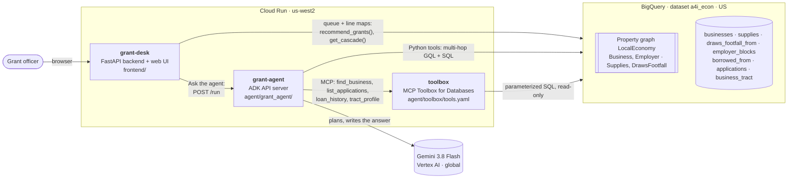
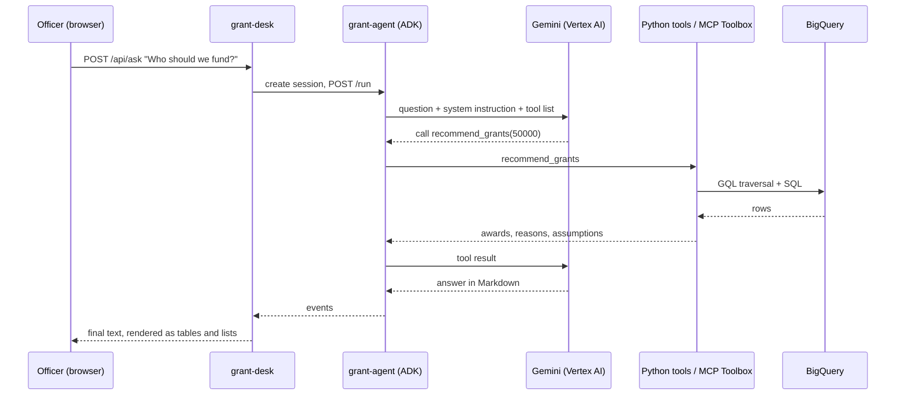

# Smart Grant Agent: architecture

How the system is built and deployed, as of 2026-11-17, in Google Cloud project
`qwiklabs-gcp-04-524776bdd295`. For what each table holds and how it was validated, see
[TEAM_NOTES.md](TEAM_NOTES.md) and [`sql/README.md`](../sql/README.md). For the product
requirements, goals and decisions, see [PRD.pdf](PRD.pdf), and for what is built against each
requirement, [REQUIREMENTS.md](REQUIREMENTS.md). Component details:
[`agent/README.md`](../agent/README.md) (tools, allocator, tests) and
[`frontend/README.md`](../frontend/README.md) (the grant desk).

## At a glance

A grant officer works in the **grant desk**, a web app. The desk's backend draws the funding queue
and the cascade maps by calling the agent's own Python tools, and forwards free-form questions to
the **ADK agent**. The agent uses Gemini to decide which tools to call: its own Python tools for the
graph traversal and the allocation, and the **MCP Toolbox** for lookups. Every number comes from
**BigQuery**, where the corridor is modeled as the property graph `LocalEconomy`.



The desk's container bundles the same `agent/grant_agent` package the agent runs, so the queue on
screen and the agent's answers always come from the same code and data.

## Deployed services

| Service | Code | Where | Runs as | Key settings |
|---|---|---|---|---|
| **grant-desk** (the Live Demo link) | `frontend/` + `agent/grant_agent/` | Cloud Run, us-west2, 1 GiB, min 1 instance. https://grant-desk-173086820802.us-west2.run.app | default compute service account | `AGENT_URL`, `AGENT_APP=grant_agent`. Built by `frontend/cloudbuild.yaml` from the repo root |
| **grant-agent** | `agent/grant_agent/` | Cloud Run, us-west2, 512 MiB, min 1. https://grant-agent-173086820802.us-west2.run.app | default compute service account | `GOOGLE_GENAI_USE_ENTERPRISE=1` (Vertex AI), `GOOGLE_CLOUD_LOCATION=global`, `GEMINI_MODEL=gemini-3.8-flash`, `TOOLBOX_URL` |
| **toolbox** | `agent/toolbox/tools.yaml` | Cloud Run, us-west2, 512 MiB, min 1. https://toolbox-173086820802.us-west2.run.app | `toolbox-sa` (BigQuery Job User, Data Viewer, Secret Accessor) | Image `database-toolbox/toolbox:latest`; config mounted from Secret Manager at `/app/tools.yaml` |
| toolbox (second copy) | same | Cloud Run, us-central1 | `toolbox-sa` | Not used by the agent. Keep as a spare or delete |
| **BigQuery** | `sql/` | dataset `a4i_econ`, US multi-region | — | Graph queries run on on-demand billing; no reservation needed in this project |
| **Gemini** | — | Vertex AI, `global` endpoint | — | `gemini-3.8-flash`. Checked 2026-11-17: `gemini-3.8-flash` (and 3.5 Flash) is served to this project only at the `global` endpoint, not in us-central1 or us-west1. us-west2 returns `400 FAILED_PRECONDITION` for every Gemini model. |

Every service keeps one instance warm, so the recorded demo never waits on a cold start.

## The grant desk backend (`frontend/app.py`)

A small FastAPI app that serves the web UI and a JSON API.

| Method and path | What it does | Where the data comes from |
|---|---|---|
| `GET /` | Serves the UI (`frontend/static/`) | — |
| `GET /api/recommendation?budget=50000` | The funding queue: awards, % of ask, closure risk before and after, reasons, runner-up, assumptions, sensitivity, plus each applicant's tract poverty and the corridor average | `grant_agent.tools.recommend_grants()`, then `business_tract` |
| `GET /api/cascade/{business_id}` | One applicant's cascade for the line map: exposed businesses by hop and the 15 strongest paths with link strengths | `grant_agent.tools.get_cascade()` |
| `GET /api/audit?budget=50000` | The equity audit of the same plan, for the desk's "Equity check" line and audit view | `grant_agent.tools.audit_allocation()` (reuses the cached plan) |
| `POST /api/ask` `{question, business_id}` | Opens a new ADK session on the agent, sends the question to `POST /run`, and returns the agent's final text | The deployed agent, via `AGENT_URL` |

Behaviors worth knowing:

- **Live or sample.** At startup the backend imports `grant_agent.tools` and checks that
  `recommend_grants` and `get_cascade` exist. If they do, it's **live**. If not (the package is
  missing or still a scaffold), it serves `frontend/sample/` and the UI shows an amber notice.
  `GRANT_DATA_MODE=live` makes a failed import an error instead, and `GRANT_DATA_MODE=sample`
  forces the sample. In sample mode, a budget other than the captured $50,000 returns 422.
- **Failures are explicit.** If live data fails, `/api/recommendation` returns 503 with a short
  message and logs the cause. `/api/ask` returns 502 if the agent's event list is malformed or
  reports an error. It answers with the model's final text only, never tool calls, tool
  responses or thoughts.
- **Caching.** The recommendation is cached per budget for the life of the instance. The first
  load after a deploy takes about 9 seconds; after that it's instant.
- **One session per question.** Each "Ask the agent" question starts a fresh session, so the agent
  doesn't remember the previous question.
- **Rendering.** The agent answers in Markdown. The UI renders it with `marked` and sanitizes it
  with `DOMPurify`, because it's model output. If the CDN is unreachable, it shows plain text.

## The agent (`agent/grant_agent/`)

| File | Role |
|---|---|
| `agent.py` | Defines `root_agent` (Gemini model from `GEMINI_MODEL`) with four Python tools (`recommend_grants`, `get_cascade`, `exposed_non_applicants`, `audit_allocation`), plus the Toolbox tools when `TOOLBOX_URL` is set |
| `prompt.py` | System instruction: who the officer is, which tool answers which question, the answer format, and the rules (every number from a tool, say what's modeled, refuse when the data can't separate two applicants, no race or ethnicity) |
| `tools.py` | `get_cascade(business_id, depth=2)`: multi-hop GQL over `LocalEconomy`, following `Supplies` forward, skipping any path with a link below 0.02, strongest path per exposed business. Returns the GQL `traversal` and `min_link` it used, and always includes a multi-hop path when one exists. `recommend_grants(budget)`: loads applications, tract need, industry alternatives and SBA charge-offs, traces every cascade in one query, then calls the allocator. `exposed_non_applicants()`: businesses downstream of applicants that never applied. `audit_allocation(budget)`: the equity audit of the plan (see `audit.py`) |
| `audit.py` | The equity audit behind `audit_allocation`: sector shares of corridor, applicants and money with over/under flags and a likely cause; tract poverty and car access, dollar-weighted; how much value rests on modeled cascades. Separates "who applied" from "how the allocator chose". Industry, poverty and car access only, never race |
| `allocator.py` | Pure Python, no BigQuery. Value of a grant = drop in the applicant's closure risk × (1 + contagion × uniqueness × downstream exposure) × neighborhood need. Allocates in slices to maximize need-weighted protection, counting every business once. Reports the unweighted count of expected closures avoided. Reruns under 5 alternative assumptions to show which awards are stable. Refuses duplicate registrations and invalid budgets or requests. All assumptions are in one `ASSUMPTIONS` dict |
| `tests/test_allocator.py` | Seven unit tests, no credentials needed (`cd agent && python -m pytest tests`). They cover the robust hub (including the shape of Tradespace's real paths through `_cascades`), leaves, the budget, duplicates, the unweighted total, overlap counted once, and the path limit |

The traversal at the heart of it, in `tools.py`:

```sql
GRAPH a4i_econ.LocalEconomy
MATCH p = (seed:Business)-[:Supplies]->{1,2}(x:Business)
WHERE seed.business_id IN (...) AND x.business_id != seed.business_id
RETURN seed.business_id AS seed_id, TO_JSON(p) AS path_json
```

Each returned path is parsed into nodes and link intensities. **Weakest-link rule:** any path
containing a link below 0.02 (2 cents per input dollar) is dropped. This keeps a generic
supplier, like Tradespace's data hosting at about 0.015 per link, from looking like a hub. For
each exposed business, only the strongest remaining path is kept. Depth is clamped to 1 to 3,
and IDs are checked against `^[A-Za-z0-9._-]{1,64}$` before they go into the query.

`agent/grant_tools/` holds a second, tested version of this query. It returns paths with
`NODES(p)` and applies the same cutoff in SQL. It's a reference, not called in production.

## The MCP Toolbox (`agent/toolbox/tools.yaml`)

The managed MCP server the challenge requires. It only runs the four read-only, parameterized
queries defined in `tools.yaml`, so the agent can't run arbitrary SQL.

| Tool | Returns |
|---|---|
| `list_applications` | All 11 applications with business, amount requested and hardship note |
| `find_business(name_contains)` | Businesses whose name matches, with `business_id` |
| `loan_history(business_id)` | Real SBA 7(a) loans, including charge-offs. Most businesses have none; the tool then returns the text "The query returned 0 rows." |
| `tract_profile(business_id)` | Tract poverty, car access, public assistance and median income (ACS 2019) |

The agent connects over MCP at `TOOLBOX_URL/mcp`. The old `/api/...` endpoints return 410 in this
Toolbox version; that's expected.

## How a request flows

**Opening the desk.** The browser calls `/api/recommendation`. The backend runs `recommend_grants`:
four BigQuery queries (applications with tract need, corridor poverty, charge-offs, and one GQL
traversal for all 11 applicants), then the allocator. The desk adds two small queries for the
neighborhood numbers, and the UI draws the queue and the budget bar.

**Opening a case.** The browser calls `/api/cascade/{id}`. The backend runs `get_cascade`, one GQL
traversal, and the UI draws the line map: the applicant on the left, each hop to the right, line
thickness by link strength.

**Asking the agent.**



Typical times: 5 seconds for a lookup question, about 15 seconds for a full recommendation.

## Deploying

Run from the repo root, with the project set (`gcloud config set project qwiklabs-gcp-04-524776bdd295`).

**Grant desk.** Rebuild after any change to `frontend/` or to the agent's tools:

```bash
gcloud builds submit --config frontend/cloudbuild.yaml --region us-west2 .
gcloud run deploy grant-desk --region us-west2 \
  --image us-west2-docker.pkg.dev/qwiklabs-gcp-04-524776bdd295/cloud-run-source-deploy/grant-desk:live
```

**Agent.**

```bash
cd agent && adk deploy cloud_run --project qwiklabs-gcp-04-524776bdd295 --region us-west2 \
  --service_name grant-agent --with_ui \
  --env GOOGLE_CLOUD_LOCATION=global \
  --env GEMINI_MODEL=gemini-3.8-flash \
  --env TOOLBOX_URL=https://toolbox-173086820802.us-west2.run.app \
  ./grant_agent -- --min-instances=1
```

`--region` is where the service runs; `GOOGLE_CLOUD_LOCATION` is where Gemini is called. Left
alone, `adk deploy` sets `GOOGLE_CLOUD_LOCATION` to the `--region` value, hence the `--env`
override. Checked 2026-11-17: `gemini-3.8-flash` (and 3.5 Flash) is served to this project only at the `global` endpoint, not in us-central1 or us-west1. us-west2 returns `400 FAILED_PRECONDITION` for every Gemini model. To fall back to 2.5 Flash, set `GEMINI_MODEL=gemini-2.5-flash`;
it works at `global` and in us-central1.

**Toolbox.** After editing `agent/toolbox/tools.yaml`, run the deploy script. It reuses the
service account, uploads `tools.yaml` as a new version of the `tools` secret, and redeploys the
service. Its `REGION` defaults to us-central1, which would update the idle spare, so set it to
the region the agent uses:

```bash
REGION=us-west2 bash agent/toolbox/deploy.sh
```

**Data.** Run the files in `sql/` in order; each replaces what it creates.

## Configuration

| Service | Variable | Value in the deployment | Purpose |
|---|---|---|---|
| grant-agent | `GOOGLE_GENAI_USE_ENTERPRISE` | `1` | Gemini through Vertex AI (ADK's name for it; the older `GOOGLE_GENAI_USE_VERTEXAI=TRUE` also works) |
| grant-agent | `GOOGLE_CLOUD_PROJECT` | `qwiklabs-gcp-04-524776bdd295` | Project for Vertex AI and BigQuery |
| grant-agent | `GOOGLE_CLOUD_LOCATION` | `global` | Where Gemini is called. 3.8 Flash is served only here; us-west2 fails for every model |
| grant-agent | `GEMINI_MODEL` | `gemini-3.8-flash` | The model behind `root_agent`. The code's default, if unset, is `gemini-2.5-flash` |
| grant-agent | `TOOLBOX_URL` | `https://toolbox-173086820802.us-west2.run.app` | Adds the MCP Toolbox tools. Without it, the agent runs on its Python tools only |
| grant-desk | `AGENT_URL` | `https://grant-agent-173086820802.us-west2.run.app` | Where "Ask the agent" goes. Without it, `/api/ask` returns 503 |
| grant-desk | `AGENT_APP` | `grant_agent` | ADK app name |
| grant-desk | `GOOGLE_CLOUD_PROJECT` | unset (the code's default is the lab project) | Project for BigQuery |
| grant-desk | `GRANT_DATA_MODE` | unset (`auto`) | `auto` falls back to the sample if the agent package can't be imported; `live` fails instead; `sample` forces the sample |
| toolbox | config file | `tools` secret in Secret Manager, mounted at `/app/tools.yaml` | Source: [`agent/toolbox/tools.yaml`](../agent/toolbox/tools.yaml) |

Each service also answers on Cloud Run's older URL form (`https://<service>-2t7btqn2ya-wl.a.run.app`).
The table uses the project-number form.

## Security and access

- **Read-only data access.** The Toolbox can only run the four parameterized `SELECT`s in
  `tools.yaml`, and its BigQuery source is set to `readOnly: true`, limited to the `a4i_econ`
  dataset. The Python tools build their SQL from IDs checked against
  `^[A-Za-z0-9._-]{1,64}$`, and from the clamped depth.
- **Model output is sanitized.** The desk renders the agent's Markdown through DOMPurify.
- **Open endpoints.** The desk calls the agent, and the agent calls the Toolbox, without identity
  tokens, so all three services accept unauthenticated requests. That's acceptable for a demo over
  public data with read-only queries. For real use, require IAM invocation and send ID tokens.
- **Service accounts.** The Toolbox runs as `toolbox-sa`, which has only BigQuery Job User, Data
  Viewer and Secret Accessor. The desk and the agent run as the default compute service account,
  which is broader than the PRD's least-privilege target.
- **No personal data.** The business registry arrives already filtered, with sole proprietors and
  home addresses removed. Race and ethnicity are not used anywhere in the reasoning.

## Known issues

| Issue | Effect | Status |
|---|---|---|
| The allocator funded Tradespace, a healthy hub with 113 weak generic links, first and in full | Contradicted "don't fund the robust hub" | **Fixed.** The weakest-link rule (PR #12) leaves Tradespace one dependent business, and it isn't funded. The applicant swap (PR #13) put three real cascades in the queue. Sour Flour is now grant 1 |
| A redeploy of the agent reset its Gemini location to us-west2 | Every question failed with a 500 | **Root cause found:** `adk deploy` sets `GOOGLE_CLOUD_LOCATION` to `--region` unless overridden. The deploy command above passes `--env GOOGLE_CLOUD_LOCATION=global`. Since PR #15, the agent also refuses to start with a location other than us-central1 or global |
| Two Toolbox services | Confusion about which one is live | The agent uses us-west2; the us-central1 copy is idle |
| First load after a desk deploy takes about 9 seconds | A slow first impression | Open the desk once before recording |
| Each question starts a new agent session | Follow-ups don't remember earlier questions | Acceptable for the demo |
| In sample mode the desk ignored the `budget` parameter | The sample always showed the $50,000 run | **Fixed** (PR #15): other budgets return 422 in sample mode |
| The traversal returns at most 50,000 paths | Cascades would be undercounted if the limit were hit | **Fixed** (PR #15): hitting the limit is now an error, not a silent truncation. Not reached here: every 1-to-3-hop `Supplies` path in the corridor totals 26,124 |
| The reported "expected closures avoided" included the need multiplier | The headline number wasn't strictly a count of closures | **Fixed** (PR #15): the reported total is unweighted (4.18); need still drives who is funded |
| The desk and the agent use the default compute service account | Broader access than needed | Open. See Security and access |
| No run log of inputs, queries and outputs (a PRD auditability target) | A recommendation can't be replayed later from a log | Open. The allocation is deterministic, so rerunning on the same tables reproduces it |
