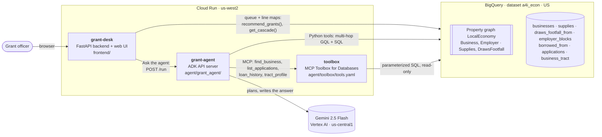
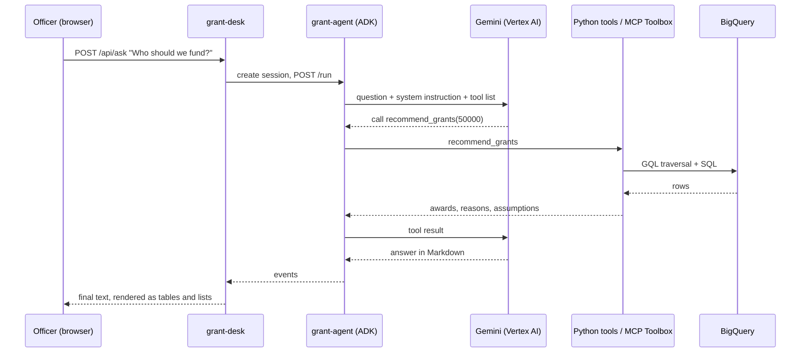

# Smart Grant Agent: architecture

How the system is built and deployed, as of 2026-11-17, in Google Cloud project
`qwiklabs-gcp-04-524776bdd295`. For what each table holds and how it was validated, see
[TEAM_NOTES.md](TEAM_NOTES.md) and [`sql/README.md`](../sql/README.md). For the product
requirements, goals and decisions, see [PRD.pdf](PRD.pdf).

## At a glance

A grant officer works in the **grant desk**, a web app. The desk's backend draws the funding queue
and the cascade maps by calling the agent's own Python tools, and forwards free-form questions to
the **ADK agent**. The agent uses Gemini to decide which tools to call: its own Python tools for the
graph traversal and the allocation, and the **MCP Toolbox** for lookups. Every number comes from
**BigQuery**, where the corridor is modeled as the property graph `LocalEconomy`.



The desk's container bundles the same `agent/grant_agent` package the agent runs, so the queue on
screen and the agent's answers always come from the same code and data.

## Deployed services

| Service | Code | Where | Runs as | Key settings |
|---|---|---|---|---|
| **grant-desk** (the Live Demo link) | `frontend/` + `agent/grant_agent/` | Cloud Run, us-west2, 1 GiB, min 1 instance. https://grant-desk-173086820802.us-west2.run.app | default compute service account | `AGENT_URL`, `AGENT_APP=grant_agent`. Built by `frontend/cloudbuild.yaml` from the repo root |
| **grant-agent** | `agent/grant_agent/` | Cloud Run, us-west2, 512 MiB, min 1. https://grant-agent-173086820802.us-west2.run.app | default compute service account | `GOOGLE_GENAI_USE_ENTERPRISE=1` (Vertex AI), `GOOGLE_CLOUD_LOCATION=us-central1`, `GEMINI_MODEL=gemini-2.5-flash`, `TOOLBOX_URL` |
| **toolbox** | `agent/toolbox/tools.yaml` | Cloud Run, us-west2, 512 MiB, min 1. https://toolbox-173086820802.us-west2.run.app | `toolbox-sa` (BigQuery Job User, Data Viewer, Secret Accessor) | Image `database-toolbox/toolbox:latest`; config mounted from Secret Manager at `/app/tools.yaml` |
| toolbox (second copy) | same | Cloud Run, us-central1 | `toolbox-sa` | Not used by the agent. Keep as a spare or delete |
| **BigQuery** | `sql/` | dataset `a4i_econ`, US multi-region | — | Graph queries run on on-demand billing; no reservation needed in this project |
| **Gemini** | — | Vertex AI, us-central1 | — | Gemini is not available to this project in us-west2 (`FAILED_PRECONDITION`) |

Every service keeps one instance warm, so the recorded demo never waits on a cold start.

## The grant desk backend (`frontend/app.py`)

A small FastAPI app that serves the web UI and a JSON API.

| Method and path | What it does | Where the data comes from |
|---|---|---|
| `GET /` | Serves the UI (`frontend/static/`) | — |
| `GET /api/recommendation?budget=50000` | The funding queue: awards, % of ask, closure risk before and after, reasons, runner-up, assumptions, sensitivity, plus each applicant's tract poverty and the corridor average | `grant_agent.tools.recommend_grants()`, then `business_tract` |
| `GET /api/cascade/{business_id}` | One applicant's cascade for the line map: exposed businesses by hop and the 15 strongest paths with link strengths | `grant_agent.tools.get_cascade()` |
| `POST /api/ask` `{question, business_id}` | Opens a new ADK session on the agent, sends the question to `POST /run`, and returns the agent's final text | The deployed agent, via `AGENT_URL` |

Behaviors worth knowing:

- **Live or sample.** At startup the backend imports `grant_agent.tools` and checks that
  `recommend_grants` and `get_cascade` exist. If they do, it's **live**. If not (the package is
  missing or still a scaffold), it serves `frontend/sample/` and the UI shows an amber notice.
- **Caching.** The recommendation is cached per budget for the life of the instance. The first
  load after a deploy takes about 9 seconds; after that it's instant.
- **One session per question.** Each "Ask the agent" question starts a fresh session, so the agent
  doesn't remember the previous question.
- **Rendering.** The agent answers in Markdown. The UI renders it with `marked` and sanitizes it
  with `DOMPurify`, because it's model output. If the CDN is unreachable, it shows plain text.

## The agent (`agent/grant_agent/`)

| File | Role |
|---|---|
| `agent.py` | Defines `root_agent` (Gemini model from `GEMINI_MODEL`) with three Python tools, plus the Toolbox tools when `TOOLBOX_URL` is set |
| `prompt.py` | System instruction: who the officer is, which tool answers which question, the answer format, and the rules (every number from a tool, say what's modeled, refuse when the data can't separate two applicants, no race or ethnicity) |
| `tools.py` | `get_cascade(business_id, depth=2)`: multi-hop GQL over `LocalEconomy`, following `Supplies` forward, strongest path per exposed business. `recommend_grants(budget)`: loads applications, tract need, industry alternatives and SBA charge-offs, traces every cascade in one query, then calls the allocator. `exposed_non_applicants()`: businesses downstream of applicants that never applied |
| `allocator.py` | Pure Python, no BigQuery. Value of a grant = drop in the applicant's closure risk × (1 + contagion × uniqueness × downstream exposure) × neighborhood need. Allocates in slices to maximize expected closures avoided, and reruns under 5 alternative assumptions to show which awards are stable. All assumptions are in one `ASSUMPTIONS` dict |
| `tests/test_allocator.py` | Unit tests for the allocator (`cd agent && python -m pytest tests`) |

The traversal at the heart of it, in `tools.py`:

```sql
GRAPH a4i_econ.LocalEconomy
MATCH p = (seed:Business)-[:Supplies]->{1,2}(x:Business)
WHERE seed.business_id IN (...) AND x.business_id != seed.business_id
RETURN seed.business_id AS seed_id, TO_JSON(p) AS path_json
```

`agent/grant_tools/` holds a second, tested version of this query that returns paths with
`NODES(p)` and applies a weakest-link cutoff. It's a reference, not called in production.

## The MCP Toolbox (`agent/toolbox/tools.yaml`)

The managed MCP server the challenge requires. It only runs the four read-only, parameterized
queries defined in `tools.yaml`, so the agent can't run arbitrary SQL.

| Tool | Returns |
|---|---|
| `list_applications` | All 11 applications with business, amount requested and hardship note |
| `find_business(name_contains)` | Businesses whose name matches, with `business_id` |
| `loan_history(business_id)` | Real SBA 7(a) loans, including charge-offs. Most businesses have none; the tool then returns the text "The query returned 0 rows." |
| `tract_profile(business_id)` | Tract poverty, car access, public assistance and median income (ACS 2019) |

The agent connects over MCP at `TOOLBOX_URL/mcp`. The old `/api/...` endpoints return 410 in this
Toolbox version; that's expected.

## How a request flows

**Opening the desk.** The browser calls `/api/recommendation`. The backend runs `recommend_grants`:
four BigQuery queries (applications with tract need, corridor poverty, charge-offs, and one GQL
traversal for all 11 applicants), then the allocator. The desk adds two small queries for the
neighborhood numbers, and the UI draws the queue and the budget bar.

**Opening a case.** The browser calls `/api/cascade/{id}`. The backend runs `get_cascade`, one GQL
traversal, and the UI draws the line map: the applicant on the left, each hop to the right, line
thickness by link strength.

**Asking the agent.**



Typical times: 5 seconds for a lookup question, about 15 seconds for a full recommendation.

## Deploying

Run from the repo root, with the project set (`gcloud config set project qwiklabs-gcp-04-524776bdd295`).

**Grant desk.** Rebuild after any change to `frontend/` or to the agent's tools:

```bash
gcloud builds submit --config frontend/cloudbuild.yaml --region us-west2 .
gcloud run deploy grant-desk --region us-west2 \
  --image us-west2-docker.pkg.dev/qwiklabs-gcp-04-524776bdd295/cloud-run-source-deploy/grant-desk:live
```

**Agent.**

```bash
cd agent && adk deploy cloud_run --project qwiklabs-gcp-04-524776bdd295 --region us-west2 \
  --service_name grant-agent --with_ui ./grant_agent
# Then always restore the settings; a redeploy can reset GOOGLE_CLOUD_LOCATION to us-west2,
# where Gemini fails:
gcloud run services update grant-agent --region us-west2 --min-instances 1 \
  --update-env-vars GOOGLE_CLOUD_LOCATION=us-central1,GEMINI_MODEL=gemini-2.5-flash,TOOLBOX_URL=https://toolbox-173086820802.us-west2.run.app
```

**Toolbox.** After editing `agent/toolbox/tools.yaml`, upload it as a new version of the `tools`
secret and redeploy the `toolbox` service (build guide, step 9).

**Data.** Run the files in `sql/` in order; each replaces what it creates.

## Known issues

| Issue | Effect | Status |
|---|---|---|
| The allocator funds Tradespace, a healthy hub with 113 weak generic links, first and in full | Contradicts "don't fund the robust hub"; judges ask about this | Open. Fix and evidence in [TEAM_NOTES.md](TEAM_NOTES.md#qa-findings-for-the-agent-lane) |
| A redeploy of the agent may reset its Gemini location to us-west2 | Every question fails with a 500 | Re-run the settings command above after each agent deploy |
| Two Toolbox services | Confusion about which one is live | The agent uses us-west2; the us-central1 copy is idle |
| First load after a desk deploy takes about 9 seconds | A slow first impression | Open the desk once before recording |
| Each question starts a new agent session | Follow-ups don't remember earlier questions | Acceptable for the demo |
