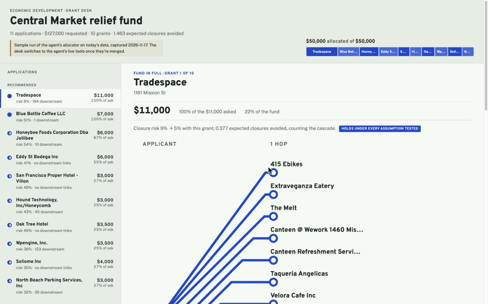

# Data, graph and grant desk: what's built and how to use it

From the architect / data lane (Sankar), 2026-11-17. Track: **Main Street relief**, corridor:
**Central Market**. The agent itself is the agent lane's; see [`agent/BUILD_GUIDE.md`](../agent/BUILD_GUIDE.md).

## In one minute

- **Everything is deployed and connected.** The grant desk (the Live Demo link,
  https://grant-desk-173086820802.us-west2.run.app) shows live numbers from the agent's tools, and
  its "Ask the agent" box answers through the deployed ADK agent, which uses the MCP Toolbox. How
  the pieces fit, with diagrams: [ARCHITECTURE.md](ARCHITECTURE.md).
- **BigQuery is ready.** The property graph `a4i_econ.LocalEconomy` and the tables `applications`
  and `business_tract` exist in the lab project.
- **The robust-hub finding is fixed.** The weakest-link rule (PR #12) and an applicant queue with
  real cascades (PR #13) mean Tradespace is no longer funded, and Sour Flour (97 businesses
  downstream) is grant 1. See the QA findings below, and the
  [hub check](../README.md#hub-check-the-same-50000-three-ways) for the side-by-side numbers.

## What's in BigQuery

Project `qwiklabs-gcp-04-524776bdd295`, dataset `a4i_econ` (US multi-region).

| Object | Rows | What it is | Real or modeled |
|---|---|---|---|
| `businesses` | 230 | Central Market businesses: name, address, NAICS industry, coordinates | Real (SF registry) |
| `supplies` | 994 | Edge, supplier → buyer, with `intensity` | Modeled: real BEA industry rates, pairing assigned by industry match and distance |
| `draws_footfall_from` | 1,016 | Edge, employer census block → business | Modeled: real job counts, allocation assigned |
| `employer_blocks` | 122 | Census blocks with job counts | Real (Census LEHD) |
| `borrowed_from` | 4 | SBA 7(a) loans, including charge-offs | Real, but only 4 in this corridor |
| `tract_demographics` | 7 | The organizers' tract table | Real, but covers the wrong tracts (see below) |
| **`LocalEconomy`** | graph | Nodes `Business`, `Employer`; edges `Supplies`, `DrawsFootfall` | Built by us, names match the build guide |
| **`applications`** | 11 | The officer's queue, $118,000 requested; applicants chosen on purpose (see `sql/02_applications.sql`) | Businesses real; every financial field illustrative |
| **`business_tract`** | 230 | Each business's census tract, poverty, car access, assistance, income | Real, ACS 2019 five-year |

The bold rows are ours. To rebuild any of them, run the files in [`sql/`](../sql/) in order; each
replaces what it creates. [`sql/README.md`](../sql/README.md) has the commands and checks.

**Checked on the loaded data:** keys are unique (no silently multiplied paths); 86 businesses
reach someone two hops down, matching the challenge brief; every business has census data; corridor
average poverty is 21.5%.

**Graph queries work without our own reservation.** Creating one failed on a Qwiklabs-wide quota
(10 of 10 used), but multi-hop `MATCH` queries run fine. If one fails with a reservation error,
tell a coach.

### The census fix (say this right in the deck)

The guide joins `tract_demographics`, but that table's 7 tracts contain only 2 of our 230
businesses. And the newest census table (ACS 2020) renumbered the tracts, so it doesn't match the
public tract boundaries either. `business_tract` uses **ACS 2019 five-year estimates**, which
match the boundaries and cover all 6 corridor tracts. When quoting neighborhood numbers, say
"2019 five-year estimates."

## The grant desk



What the officer sees:

- **Header:** applications, total requested, grants, expected closures avoided, and the $50,000 bar.
  Click a bar segment or a queue row to open that case.
- **Queue:** recommended grants first (amount, % of ask, closure risk, downstream count), then not funded.
- **Case:** status and amount; closure risk before → after the grant; whether the award holds under
  every assumption tested; the cascade line map; the agent's reasons; the runner-up comparison;
  tract demographics; the assumptions in plain English; the evidence note; the strongest paths
  with link strengths; and an "Ask the agent" box.

### Run it

```bash
python3 -m venv .venv && .venv/bin/pip install -r frontend/requirements.txt
.venv/bin/uvicorn app:app --app-dir frontend --port 8080      # from the repo root
# open http://localhost:8080
```

### Where its numbers come from

1. **Live** (the deployed desk today): the desk imports the agent's `recommend_grants()` and
   `get_cascade()` and calls them directly.
2. **Sample**, if the agent package is missing (for example, running only `frontend/` locally):
   `frontend/sample/*.json`, captured by running the same allocator on the live tables. The page
   shows an amber notice saying so.

The **Ask the agent** box forwards to the deployed agent through the ADK API server, using
`AGENT_URL` (set on the deployed desk). Answers render as formatted tables and lists.

### What the desk expects from the agent's tools

If you change these tools, keep these fields or tell us:

- `recommend_grants(budget)`: `budget`, `allocated`, `unallocated`,
  `expected_closures_avoided_total`, `recommended[]` and `not_funded[]` (each with `business_id`,
  `name`, `address`, `requested`, `award`, `pct_of_request`, `pct_of_budget`, `baseline_risk`,
  `risk_after_award`, `downstream_exposed`, `closures_avoided_by_this_grant`,
  `closures_avoided_per_10k_if_fully_funded`, `reasons[]`), `runner_up`, `weakest_funded`,
  `assumptions`, `sensitivity.funded_in_every_scenario`, `sensitivity.funded_ids_by_scenario`,
  `sensitivity.note`, `evidence_note`.
- `get_cascade(business_id)`: `business`, `depth`, `exposed_count`, `by_hop`,
  `local_alternatives_same_industry`, `is_leaf`, and `paths[]` with `path` ("A → B → C"),
  `hops`, `weight`, `link_intensities`.

**Live:** https://grant-desk-173086820802.us-west2.run.app (Cloud Run service `grant-desk`,
us-west2, minimum 1 instance), serving live numbers. To redeploy it, see
[ARCHITECTURE.md, Deploying](ARCHITECTURE.md#deploying).

## QA findings for the agent lane

**Status: resolved.** Both suggested fixes below are in:

- The 0.02 weakest-link rule is in `tools._cascades`, with a regression test (PR #12).
- The applicant queue now includes Sour Flour, The Warfield Theater and Non Plus Ultra (PR #13).

Live result at $50,000: Sour Flour is grant 1 ($5,000, 97 businesses downstream), and
Tradespace is not funded. 9 grants, $49,500 allocated, and expected closures avoided rose from
1.19 to 4.14. The original findings follow, for the record.

From running the build guide's allocator, unchanged, on the real tables (depth 2, $50,000):

1. **The robust hub is funded first.** Tradespace (data hosting, 9% closure risk) gets its full
   $11,000 as grant 1 of 10, and the desk tags it "holds under every assumption tested." At two
   hops its 113 weak, generic supply links reach 194 businesses, which outweighs its low risk. The
   guide's `test_robust_hub_is_not_funded_first` passes on its made-up data but fails here. Judges
   will ask "when does your agent not fund the biggest hub?"
2. **A cutoff alone isn't enough.** Requiring every link in a path to be at least 0.02 (2 cents per
   input dollar) drops Tradespace. But the remaining applicants then have 0 to 2 downstream
   businesses, so the ranking becomes distress only: the "rank by trouble" approach the challenge
   argues against. The cause is the applicant list: the random "deep" picks landed on tech firms and
   a parking operator, whose links are all weak.
3. **The money is spread thin:** 10 of 11 applicants funded, most at 25 to 27% of what they asked.

Suggested fix (both parts done; see the status above):

- Add the 0.02 weakest-link rule to `_cascades` in `tools.py`. A tested version is in
  [`agent/grant_tools/cascade.sql`](../agent/grant_tools/cascade.sql).
- Swap two or three "deep" applicants for businesses with real cascades, for example:
  - Sour Flour (`16`) or Cumaica Coffee (`24`): 94 businesses downstream, 28 of them two or more hops out
  - The Warfield Theater (`114`) or Non Plus Ultra (`66`): smaller, tight cascades

  The data lane will update `sql/02_applications.sql` once you agree.

One more tip: the guide's `TO_JSON(p)` parsing is untested. `agent/grant_tools/cascade.sql`
reads paths with `NODES(p)` and `UNNEST(d)` instead, and that works on this data.

## Branches

| Branch | What's on it |
|---|---|
| `data` | `sql/` (graph and tables), `agent/grant_tools/` (tested cascade query), `docs/` |
| `frontend` | `frontend/` (the grant desk, its Dockerfile and sample data) |
| `agent` | the agent lane's work |
| `hub-fix`, `applicant-swap` | The QA fixes above (PRs #12 and #13) |
| `docs` | The project README, component READMEs, requirements status and `scripts/hub_check.py` |

Merge into `main` through pull requests; check the open PRs for what isn't in yet.

## Equity audit (for the deck)

From the live allocation ($50,000, 9 grants, $49,500), against all 230 corridor businesses.
Updated after the applicant swap; the earlier figures described a different queue.

- **The money reaches poorer tracts.** Dollar-weighted tract poverty of the grants is 24.8%,
  against a corridor average of 21.5%. 8 of the 9 grants are in tracts above that average; Sour
  Flour (18.3%) is the exception. Dollar-weighted share of households without a car is 80.7%,
  against 73.8%.
- **The industry bias the brief predicted shows up, and the queue adds to it.**

  | Industry group (NAICS) | Share of grant dollars | Share of corridor businesses |
  |---|---:|---:|
  | Food and lodging (72) | 51.5% | 28.3% |
  | Manufacturing, including Sour Flour's bakery (31–33) | 18.2% | 6.5% |
  | Retail (44–45) | 18.2% | 12.6% |
  | Arts and recreation (71) | 12.1% | 4.8% |
  | Tech and professional services (51, 54) | 0% | 24.8% |
  | Personal and other services (81) | 0% | 12.2% |
  | Health and social services (62) | 0% | 10.9% |

  Input-heavy industries get more modeled supply links, which is the bias the brief warns about.
  We also chose applicants *with* real cascades, and those are mostly food businesses. Tech has
  one applicant, Tradespace, unfunded on purpose. Personal and health services had no
  applicants. Say both causes in the deck.

## Still open

- After any agent redeploy, restore its Gemini location (see [ARCHITECTURE.md](ARCHITECTURE.md#deploying)).
- Run the build guide's test table, the seven officer questions and the failure cases, against
  the deployed agent (QA).
- Not built yet, from the PRD:
  - an automated check that every memo has all seven elements and no uncited numbers (FR-7, FR-8)
  - memo export to PDF or Docs (FR-16)
  - a per-run audit log
  - [REQUIREMENTS.md](REQUIREMENTS.md) has the full list
- Deck (6 slides) and pitch video (under 3 minutes).
