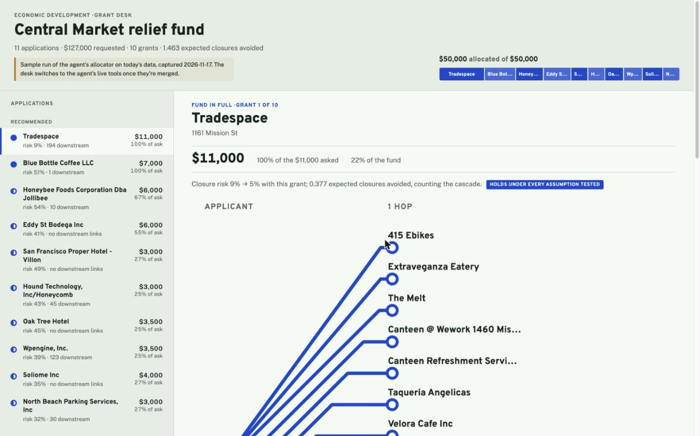

# frontend/: the grant desk

The officer's screen: a funding queue for the Central Market relief fund. It shows each
applicant's award and the cascade behind it as a transit-style line map, plus an "Ask the agent"
box. It's the project's live demo link, deployed as the Cloud Run service `grant-desk`:
https://grant-desk-173086820802.us-west2.run.app.

The desk doesn't compute anything itself. Its backend imports the agent's own tools
(`agent/grant_agent/tools.py`) and calls them directly, so the queue on screen and the agent's
answers come from the same code and data.



| File | What it is |
|---|---|
| [`app.py`](app.py) | FastAPI backend: serves the UI and a small JSON API |
| [`static/index.html`](static/index.html), [`static/app.js`](static/app.js), [`static/styles.css`](static/styles.css) | The UI: plain JavaScript modules, no build step |
| [`sample/recommend_grants.json`](sample/recommend_grants.json), [`sample/get_cascade.json`](sample/get_cascade.json) | Saved tool output, served when the agent package can't be imported |
| [`Dockerfile`](Dockerfile), [`cloudbuild.yaml`](cloudbuild.yaml) | The deployed image: the desk plus `agent/grant_agent`, built from the repo root |
| [`Procfile`](Procfile) | Start command for a source deploy of `frontend/` alone (sample mode) |
| [`requirements.txt`](requirements.txt) | `fastapi`, `uvicorn`, `google-cloud-bigquery` |

## What the officer sees

- **Header:** number of applications, total requested, number of grants, expected closures
  avoided, and the budget bar with one segment per grant. Click a segment to open that case.
- **Queue:** recommended grants first, with the amount, % of the ask, closure risk and number of
  businesses downstream. Then the applicants not funded.
- **Case view**, for the selected applicant:
  - status ("Fund in full", "Partial grant", "Not funded") and amount
  - closure risk before → after the grant
  - whether the award holds under every assumption tested
  - the **cascade line map:** the applicant on the left, one column per hop, line thickness by
    link strength
  - the agent's reasons
  - the comparison with the runner-up
  - tract poverty against the corridor average
  - the assumptions in plain English
  - the evidence note
  - the strongest paths with their link strengths
- **Ask the agent:** a question box prefilled with "Why fund X and not the runner-up?" or "Why
  isn't X funded?". The answer arrives as Markdown and is rendered with
  [marked](https://marked.js.org/). It's sanitized with
  [DOMPurify](https://github.com/cure53/DOMPurify), because it's model output. Both load from
  jsDelivr on first use. If the CDN is unreachable, the answer shows as plain text.

## API

| Method and path | Does | Source |
|---|---|---|
| `GET /` | Serves `static/` | — |
| `GET /api/recommendation?budget=50000` | The funding queue: the full `recommend_grants()` output, plus `neighborhood` (each applicant's tract, poverty and no-vehicle rate) and `corridor_poverty`. Also `source`: `"live"` or `"sample"` | `grant_agent.tools.recommend_grants()`, then two queries on `business_tract` |
| `GET /api/cascade/{business_id}` | One applicant's cascade for the line map. 404 if the business doesn't exist | `grant_agent.tools.get_cascade()` |
| `POST /api/ask` `{"question": "...", "business_id": "16"}` | Creates an ADK session on the deployed agent, sends the question (with the business ID appended) to `POST /run`, and returns `{"answer": "<the agent's last text>"}` | The agent at `AGENT_URL` |

Error handling for `/api/ask`:

- **503** when `AGENT_URL` isn't set.
- **502** when the agent can't be reached, returns an HTTP error, or answers without text. The
  message says which.
- The request waits up to 120 seconds.

## Live or sample

At startup, `app.py` puts `agent/` on the Python path and imports `grant_agent.tools`.

- **Live:** the import works and the module has `recommend_grants` and `get_cascade`. The
  deployed desk runs this way.
- **Sample:** anything fails, such as the package missing, its dependencies missing, or the
  scaffold not written yet. The desk then serves `sample/` and the UI shows an amber notice with
  the capture date.

To refresh the sample, save the live `/api/recommendation` and `/api/cascade/{id}` output in the
same shape as the files in `sample/`.

Recommendations are cached per budget for the life of the process. The first load after a
deploy takes about 9 seconds; after that it's instant.

## Configuration

| Variable | Default | Purpose |
|---|---|---|
| `GOOGLE_CLOUD_PROJECT` | `qwiklabs-gcp-04-524776bdd295` | Project for BigQuery. Set before the agent's tools are imported |
| `AGENT_URL` | unset | The deployed agent's base URL. Without it, "Ask the agent" returns 503 |
| `AGENT_APP` | `grant_agent` | ADK app name used in the session and `/run` calls |
| `GCLOUD_ACCESS_TOKEN` | unset | Local development only: a `gcloud auth print-access-token` value, used instead of application-default credentials |
| `PORT` | `8080` | Port in the container |

On Cloud Run, the desk runs as the project's default compute service account, which needs
BigQuery read access.

## Run it locally

From the repo root:

```bash
python3 -m venv .venv
.venv/bin/pip install -r frontend/requirements.txt -r agent/grant_agent/requirements.txt
gcloud auth application-default login     # or: export GCLOUD_ACCESS_TOKEN="$(gcloud auth print-access-token)"
AGENT_URL=https://grant-agent-173086820802.us-west2.run.app \
  .venv/bin/uvicorn app:app --app-dir frontend --port 8080
# open http://localhost:8080
```

Install only `frontend/requirements.txt` to run in sample mode, with no BigQuery access needed.

## Deploy

Build from the **repo root** so the image includes `agent/grant_agent`:

```bash
gcloud builds submit --config frontend/cloudbuild.yaml --region us-west2 .
gcloud run deploy grant-desk --region us-west2 \
  --image us-west2-docker.pkg.dev/qwiklabs-gcp-04-524776bdd295/cloud-run-source-deploy/grant-desk:live
```

The service keeps `AGENT_URL`, `AGENT_APP=grant_agent`, 1 GiB of memory and one warm instance
from earlier deploys. Redeploy the desk after any change to the agent's tools too, since it
bundles them. More in [docs/ARCHITECTURE.md](../docs/ARCHITECTURE.md#deploying).
